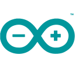
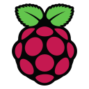
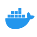

# Hello there

  
  
  

  <h2> 📫 How To Reach Me</h2>
  

     
  

  <h2> About Me </h2>
  
I'm a fullstack developer from Brazil with a master's degree from UFRPE, where I focused on applying IoT and AI in Aquaculture 4.0. During my studies, I explored new technologies, conducted R&D, and developed proof-of-concept solutions. Outside of work, I enjoy staying active with sports like running, swimming, and biking. In my free time, I also like playing video games, watching TV shows, or going out to do something fun.

## 🌱 Currently Learning
[<code></code>]()
[<code></code>]()
[<code></code>]()
[<code></code>]()
[<code></code>]()
[<code></code>]()

## What I Use For Frontend Development
[<code></code>]()
[<code></code>]()
[<code></code>]()
[<code></code>]()
[<code></code>]()
[<code></code>]()
[<code></code>]()

## What I Use For Mobile Development
[<code></code>]()
[<code></code>]()
[<code></code>]()

## What I Use For Backend Development
[<code></code>]()
[<code></code>]()
[<code></code>]()
[<code></code>]()
[<code></code>]()
[<code></code>]()
[<code></code>]()

## **🌎 Machine Learning & AI**  
[<code></code>](https://tensorflow.org/)
[<code></code>](https://keras.io/)
[<code></code>](https://scikit-learn.org/)
[<code></code>](https://pandas.pydata.org/)
[<code></code>](https://numpy.org/)
[<code></code>](https://opencv.org/)

## **⚙️ What I Use For Embedded Systems & IoT**  
[<code></code>](https://www.arduino.cc/)
[<code></code>](https://www.raspberrypi.org/)
[<code></code>](https://platformio.org/)
[<code></code>](https://espressif.com)
[<code></code>](https://thingsboard.io/)
[<code></code>](https://thingspeak.com/)
[<code></code>](https://blynk.io/)
[<code></code>](https://kicad.org/)

## **☁️ DevOps & IaC**  
[<code></code>](https://www.kernel.org/)
[<code></code>](https://en.wikipedia.org/wiki/Bash_(Unix_shell))
[<code></code>](https://www.docker.com/)
[<code></code>](https://www.ansible.com/)
[<code></code>](https://www.terraform.io/)
[<code></code>](https://kubernetes.io/)

## **Cloud AWS**  
[<code></code>](https://aws.amazon.com/)
[<code></code>](https://aws.amazon.com/ec2/)
[<code></code>](https://aws.amazon.com/ecs/)
[<code></code>](https://aws.amazon.com/eks/)
[<code></code>](https://aws.amazon.com/lambda/)
[<code></code>](https://aws.amazon.com/certificate-manager/)
[<code></code>](https://aws.amazon.com/amplify/)
[<code></code>](https://aws.amazon.com/rds/)
[<code></code>](https://aws.amazon.com/cloudformation/)

## **Cloud GCP**  
[<code></code>](https://cloud.google.com/)
[<code></code>](https://cloud.google.com/appengine)
[<code></code>](https://cloud.google.com/functions)
[<code></code>](https://cloud.google.com/compute)

## **Cloud Azure**  
[<code></code>](https://azure.microsoft.com/en-us/)

### **Most Used Programming Languages**
[<code></code>](https://www.java.com/en/)
[<code></code>](https://www.python.org/)
[<code></code>](https://en.wikipedia.org/wiki/C_(programming_language))
[<code></code>](https://en.wikipedia.org/wiki/C%2B%2B)
[<code></code>](https://www.javascript.com/)
[<code></code>](https://dart.dev/)
